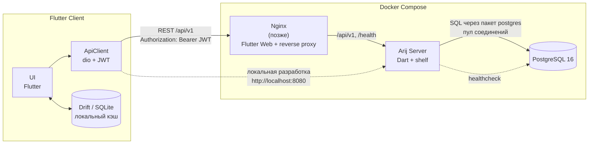
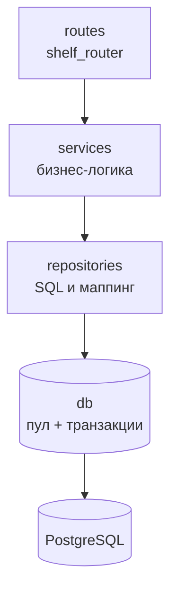
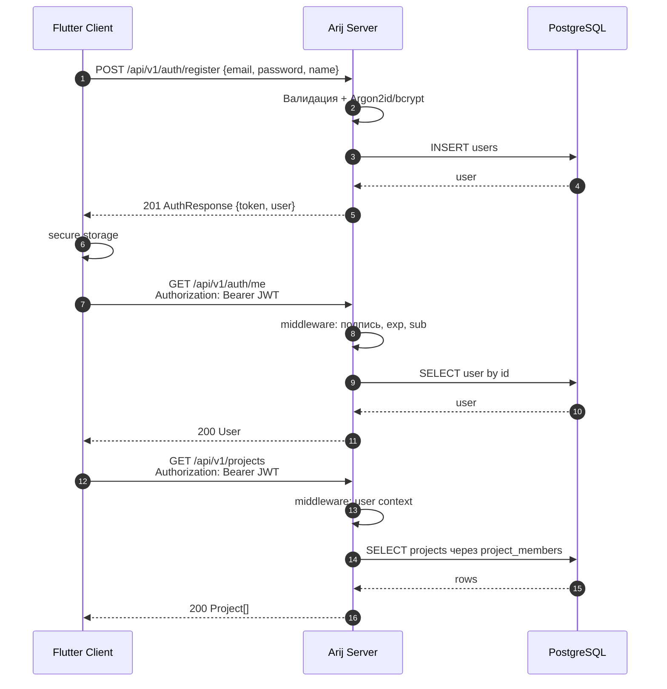
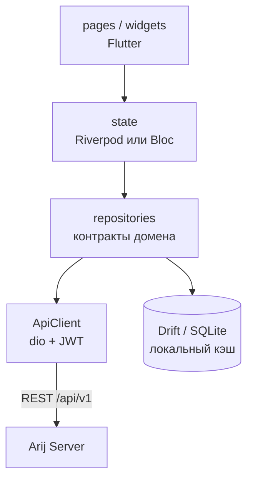

# Архитектура проекта

- **Проект:** Arij
- **Статус:** принят (этап 0, фиксирует контракт до реализации)
- **Дата:** 2026-11-21
- **Связанные документы:** [ROADMAP](ROADMAP.md), [ADR-0001](adr/0001-backend-stack.md), [OpenAPI](api/openapi.yaml)

## 1. Назначение

Документ описывает целевую архитектуру Arij: Flutter-клиент, Dart-сервер на `shelf`,
PostgreSQL, контейнерное окружение и правила, по которым развиваются API и схема БД.
Детали REST-контракта — в [OpenAPI 3.1](api/openapi.yaml); выбор серверного стека —
в [ADR-0001](adr/0001-backend-stack.md).

## 2. Контекст системы



### Компоненты

| Компонент | Ответственность | Этап |
|---|---|---|
| Flutter Client | UI, локальный кэш Drift/SQLite, вызовы REST через `ApiClient` | 1 |
| Arij Server (`shelf`) | HTTP API, валидация, бизнес-логика, JWT, доступ к PostgreSQL | 0–1 |
| PostgreSQL | Единственный источник истины для пользователей, проектов, задач | 1 |
| Docker Compose | Локальный запуск сервера и БД одной командой | 0 |
| Nginx | Раздача Flutter Web и reverse proxy на сервер | 5 (позже) |

Drift на клиенте — **только локальный кэш**. Он не определяет серверную схему и не
синхронизируется с PostgreSQL напрямую: все изменения проходят через REST API.

### Docker Compose

| Сервис | Сборка/образ | Порты | Назначение |
|---|---|---|---|
| `postgres` | `postgres:16` | `5432` (только dev) | PostgreSQL, именованный volume `arij_pgdata` |
| `server` | `./server` (Dockerfile) | `8080` | Dart-сервер `arij_server`; миграции — с этапа 1 |
| `nginx` | `nginx:alpine` | `80`/`443` | Flutter Web и reverse proxy, **этап 5** |

`docker compose up` поднимает `postgres` и `server`. Сервер ждёт готовности PostgreSQL
(healthcheck) и применяет миграции; в dev клиент ходит напрямую на
`http://localhost:8080`. Nginx добавляется на этапе 5, когда появляется Web-сборка:
он раздаёт статику и проксирует `/api/v1` и `/health` на сервер. Наружу публикуется
только Nginx; порт PostgreSQL в production не открывается.

## 3. Слои сервера

Редактируемая UML-диаграмма компонентов — [architecture.puml](architecture.puml).
Читаемое представление той же структуры — диаграмма Mermaid ниже.



| Слой | Что делает | Что запрещено |
|---|---|---|
| `routes` | Разбирает HTTP-запрос, валидирует вход, вызывает сервис, формирует статус и JSON | SQL, бизнес-правила, прямые зависимости от `postgres` |
| `services` | Бизнес-правила, проверка прав, транзакции, координация репозиториев | Знание о `shelf.Request`, HTTP-статусах и JSON-конверте |
| `repositories` | Параметризованный SQL, маппинг строк в модели, выборки | Решение о HTTP-коде и правах доступа |
| `db` | Пул соединений, транзакции, применение миграций | Бизнес-логика |

Направление зависимостей — только вниз: `routes → services → repositories → db`.
Ошибки слоёв преобразуются в единый формат на границе `routes`/middleware.

## 4. Аутентификация и авторизация



Правила:

1. Регистрация и вход — единственные операции, выдающие JWT; `/health` публичен.
2. Пароли хранятся только как Argon2id- или bcrypt-хэш. SHA-256 и открытый текст
   запрещены.
3. JWT подписывается `JWT_SECRET` (≥ 32 символа, только env), содержит `sub` (UUID
   пользователя), `iat`, `exp`. Время жизни — из конфигурации, для dev допустимо 24 часа.
4. Клиент хранит токен в `flutter_secure_storage` и передаёт его в заголовке
   `Authorization: Bearer <JWT>`.
5. Middleware проверяет подпись и срок действия, затем загружает пользователя и
   кладёт его в контекст запроса. Отсутствие/просрочка токена → `401 unauthorized`.
6. Авторизация по проекту: владелец (`owner`) может изменять проект и управлять
   участниками; участник (`member`) видит проект и его данные. Нарушение → `403 forbidden`.
7. Ошибки аутентификации не раскрывают, существует ли email: вход всегда возвращает
   `401 invalid_credentials`.

## 5. Структура каталогов `server/`

Целевая структура пакета `arij_server` (Dart 3.x). Имена файлов внутри слоёв —
ориентир, а не жёсткий контракт.

```text
server/
├── bin/
│   └── server.dart              # точка входа: env, пул, миграции, запуск shelf
├── lib/
│   └── src/
│       ├── config/
│       │   └── env.dart         # SERVER_*, DB_*, JWT_SECRET
│       ├── app.dart             # сборка pipeline: middleware + router
│       ├── routes/
│       │   ├── health_routes.dart
│       │   ├── auth_routes.dart
│       │   ├── project_routes.dart
│       │   └── member_routes.dart
│       ├── middleware/
│       │   ├── auth_middleware.dart
│       │   ├── cors_middleware.dart
│       │   ├── error_middleware.dart
│       │   └── logging_middleware.dart
│       ├── db/
│       │   ├── database.dart    # пул, транзакции
│       │   └── migrations.dart  # раннер пронумерованных SQL-файлов
│       ├── services/
│       │   ├── auth_service.dart
│       │   └── project_service.dart
│       ├── repositories/
│       │   ├── user_repository.dart
│       │   ├── project_repository.dart
│       │   └── member_repository.dart
│       └── models/              # DTO и доменные модели
├── migrations/
│   ├── 0001_users.sql
│   ├── 0002_projects.sql
│   └── 0003_project_members.sql
├── test/
├── pubspec.yaml
├── Dockerfile
└── README.md
```

- `bin/server.dart` читает env, создаёт пул, применяет миграции и запускает HTTP-сервер.
- `app.dart` не содержит бизнес-логики: только порядок middleware и маршруты.
- SQL-файлы лежат вне `lib/`, чтобы их можно было монтировать/копировать в Docker и
  применять отдельной командой в CI.
- Тесты: unit для сервисов, интеграционные для маршрутов с PostgreSQL.

## 6. Схема БД этапа 1

Полная схема фиксируется миграциями; ниже — целевые таблицы и ограничения.

### `users`

| Колонка | Тип | Ограничения |
|---|---|---|
| `id` | `uuid` | PK, `gen_random_uuid()` |
| `email` | `citext` | NOT NULL, UNIQUE |
| `password_hash` | `text` | NOT NULL |
| `name` | `text` | NOT NULL, длина 1–100 |
| `created_at` | `timestamptz` | NOT NULL, default `now()` |
| `updated_at` | `timestamptz` | NOT NULL, default `now()` |

### `projects`

| Колонка | Тип | Ограничения |
|---|---|---|
| `id` | `uuid` | PK, `gen_random_uuid()` |
| `key` | `text` | NOT NULL, UNIQUE, `^[A-Z][A-Z0-9]{1,9}$` |
| `name` | `text` | NOT NULL, длина 1–100 |
| `description` | `text` | NULL, до 2000 символов |
| `owner_id` | `uuid` | NOT NULL, FK → `users(id)` ON DELETE RESTRICT |
| `created_at` | `timestamptz` | NOT NULL, default `now()` |
| `updated_at` | `timestamptz` | NOT NULL, default `now()` |

Ключ проекта глобально уникален: он используется в номерах задач (`ARIJ-1`) и не
меняется после создания.

### `project_members`

| Колонка | Тип | Ограничения |
|---|---|---|
| `project_id` | `uuid` | FK → `projects(id)` ON DELETE CASCADE |
| `user_id` | `uuid` | FK → `users(id)` ON DELETE CASCADE |
| `role` | `text` | NOT NULL, default `member`; `CHECK (role IN ('owner','member'))` |
| `joined_at` | `timestamptz` | NOT NULL, default `now()` |

- PK: `(project_id, user_id)`.
- Индекс `project_members(user_id)` — для списка «мои проекты».
- Частичный уникальный индекс `UNIQUE (project_id) WHERE role = 'owner'` гарантирует,
  что у проекта не больше одного владельца.
- Владелец проекта также хранится в `project_members` с ролью `owner`; запись в
  `projects` и `project_members` создаётся в одной транзакции. Это упрощает проверку
  доступа и список участников.
- Инвариант: у проекта ровно один `owner` в рамках MVP.

Для `users.email` нужен `CREATE EXTENSION IF NOT EXISTS citext` (первая миграция).
`gen_random_uuid()` входит в PostgreSQL 13+ и доступен в образе `postgres:16` без
`pgcrypto`.

На этапе 2 добавляются enum `task_kind`, `task_priority`, `user_role`, таблицы
`task_types`, `statuses`, `tasks`; на этапе 3 — история переходов статусов (если
успеваем). `user_role` вводится на этапе 2 вместе с расширением ролей; на этапе 1
роль ограничена CHECK-констрейнтом.

## 7. `task_kind` и `task_type` (этап 2)

Это **разные измерения** задачи, их нельзя смешивать в одном поле.

| Понятие | Что означает | Где хранится | Значения |
|---|---|---|---|
| `task_kind` | Структурная роль в иерархии | enum `task_kind`, колонка `tasks.kind` | `epic`, `task`, `subtask` |
| `task_type` | Классификация для фильтров и отображения | таблица `task_types`, FK `tasks.type_id` | `bug`, `feature`, `custom` (настраиваемые в проекте) |

Правила:

1. `kind` — фиксированный enum, влияет на допустимые связи и нумерацию.
2. `type` — сущность проекта, которую можно расширять без миграции enum.
3. `epic` не имеет родителя; `task` может быть без родителя или внутри `epic`;
   `subtask` всегда имеет родителя-`task`.
4. `type_id` должен ссылаться на тип того же проекта; удаление используемого типа
   запрещено (`ON DELETE RESTRICT`).
5. В API используются поля `kind` и `typeId`; в документации допустимо название
   `task_type` для сущности/таблицы.

Почему не одно поле: `epic` — это не «тип бага», а уровень иерархии. Одно поле
породило бы недопустимые состояния (`epic` + `bug`), сломало бы иерархию и не
позволило бы добавлять пользовательские типы.

## 8. Принципы

### Contract-first

- Источник истины — [OpenAPI](api/openapi.yaml). Изменение контракта начинается с
  правки спецификации, затем реализуется на сервере и клиенте.
- Все прикладные маршруты версионируются префиксом `/api/v1`; `/health` остаётся
  корневым.
- Формат ошибок единый: `{"error":{"code","message","details"}}`. Новые коды —
  snake_case, добавляются в описание схемы `ErrorDetails`.
- Успешные ответы не оборачиваются в дополнительный конверт: ресурс возвращается
  напрямую, список — JSON-массивом.

### Миграции только вперёд

- Файлы `NNNN_name.sql` применяются по возрастанию номера ровно один раз.
- Уже применённая миграция не редактируется и не удаляется; исправление — новая
  миграция.
- Откат — через резервную копию или компенсирующую миграцию, не через `down`-скрипт.
- CI прогоняет все миграции на пустой PostgreSQL; сервер применяет их идемпотентно
  при старте (или отдельной командой перед запуском).

### Единые ошибки и коды

- `validation_error` → 400, `unauthorized` → 401, `forbidden` → 403,
  `*_not_found` → 404, `*_taken`/`*_exists` → 409, `internal_error` → 500.
- `message` пригоден для пользователя, `details` — структурированный контекст.
- В ответах нет stack trace, SQL, паролей, токенов и внутренних путей.
- Непредвиденные исключения логируются с request id и превращаются в
  `500 internal_error` без утечки деталей.

### Безопасность и конфигурация

- Секреты (`DB_PASSWORD`, `JWT_SECRET`) — только в env; `.env` не коммитится.
- CORS настраивается явно; в dev допустим localhost-источник Flutter Web.
- В production трафик идёт через Nginx с HTTPS; сервер не публикует порт БД наружу.
- Health-check не требует аутентификации и не раскрывает версию PostgreSQL.

### Локальная разработка

`docker compose up` поднимает PostgreSQL и сервер; переменные окружения берутся из
`.env` (шаблон — `.env.example`). Клиент ходит на `http://localhost:8080`, базовый URL
задаётся через `--dart-define=API_BASE_URL`. Nginx добавляется на этапе релиза, когда
появляется Flutter Web.

## 9. Текущая кодовая база (`main`)

Состояние на 21.11.2026 по дереву GitHub: UI-оболочка с демо-входом и локальным CRUD,
реального API и серверной авторизации пока нет.

| Путь | Назначение | Судьба |
|---|---|---|
| `lib/main.dart` | точка входа `runApp` | сохраняется |
| `lib/app/arij_app.dart`, `lib/app/theme.dart` | `MaterialApp`, тема | сохраняется |
| `lib/auth/demo_auth.dart` | демо-вход `12345/12345` | заменяется реальным auth (этап 1), демо — за флагом |
| `lib/database/app_database.dart` (+ `.g.dart`) | Drift/SQLite, таблица `Person` | остаётся локальным кэшем, сущности заменяются на API-модели |
| `lib/models/person.dart` | локальная модель `Person` | заменяется моделями API |
| `lib/repositories/person_repository.dart` | локальный CRUD | заменяется репозиториями домена |
| `lib/api/person_controller.dart` | контроллер поверх репозитория | переоформляется под API |
| `lib/pages/login_page.dart`, `register_page.dart`, `home_page.dart`, `db_demo_page.dart` | экраны | переписываются под реальный API |
| `lib/widgets/app_sidebar.dart`, `roadmap_view.dart`, `section_placeholder.dart` | навигация и заглушки разделов | сохраняются, наполняются на этапах 1–4 |
| `test/` | `demo_auth_test`, `person_controller_test`, `widget_test` — 26 тестов | тесты обновляются вместе с кодом |

Итог: клиент сейчас однослойный (`экран → контроллер → репозиторий → Drift`). Этап 1
добавляет API-слой, управление состоянием сессии и реальную авторизацию.

## 10. Клиентская архитектура (целевая)



Правила:

1. UI не знает ни об HTTP, ни о БД: только state и доменные модели.
2. Управление состоянием — один подход: Riverpod (предпочтительно) или Bloc.
   Выбирается на этапе 1 и не смешивается.
3. `ApiClient` на `dio`: базовый URL через `--dart-define=API_BASE_URL`,
   перехватчик `Authorization: Bearer`, единый разбор конверта ошибок, выход при `401`.
4. Токен — только `flutter_secure_storage`; не хранить в `SharedPreferences`.
5. Drift — только кэш: запись через API, чтение из кэша при недоступности сервера.
   Схема кэша не обязана совпадать с серверной.
6. Модели клиента отражают схемы API; маппинг DTO ↔ домен — в репозиториях.
7. Пользователю показываются доменные ошибки; технические детали — в лог.

## 11. Поверхность API

| Этап | Маршруты |
|---|---|
| 0 | `GET /health` |
| 1 | `POST /auth/register`, `POST /auth/login`, `GET /auth/me`; `GET/POST /projects`; `GET/PATCH/DELETE /projects/{id}`; `GET/POST /projects/{id}/members`; `DELETE /projects/{id}/members/{userId}` |
| 2 | `GET/POST /projects/{id}/tasks`; `GET/PATCH/DELETE /tasks/{id}`; фильтры бэклога |
| 3 | смена статуса `PATCH /tasks/{id}/status`; данные для Kanban |
| 5 | веб-сборка за Nginx, `/api/v1` → сервер |

Контракт — источник истины: изменение начинается с [OpenAPI](api/openapi.yaml),
затем реализуется на сервере и клиенте.

## 12. Развёртывание и релизы

- **CI:** GitHub Actions (self-hosted runner), jobs `lint → test → build-android +
  build-windows`, отдельный job `backend` (`dart format/analyze/test`).
- **Release:** тег `v*` → APK + AAB + Windows zip + `SHA256SUMS.txt`.
- **Этап 5:** Flutter Web за Nginx с HTTPS; Nginx проксирует `/api/v1` и `/health`
  на сервер. Порт PostgreSQL наружу не публикуется.
- **Конфигурация:** `.env` не коммитится, в репозитории — `.env.example`; секреты
  только в окружении или секрет-менеджере.

## 13. Полировка MVP (этап 4)

- **Роли:** `owner` и `member` проекта. Owner управляет проектом и участниками,
  member видит проект и данные. Расширенные роли (admin/viewer) — post-MVP.
- **Валидация:** единые правила на клиенте и сервере — email, имя 1–100, пароль
  8–128, key проекта `^[A-Z][A-Z0-9]{1,9}$`, иерархия задач, тип/статус проекта.
  Клиент не отправляет заведомо невалидные запросы; сервер всё равно проверяет.
- **Состояния UI:** каждый асинхронный список имеет `loading`, `empty` и `error`
  с кнопкой повтора. Ошибки сервера разбираются в `ApiClient` в доменные.
- **Оптимистичные обновления:** Kanban и Backlog меняют состояние локально
  и откатываются при ошибке запроса.
- **Тесты:** unit на сервисы/провайдеры, API-тесты на граничные случаи,
  интеграционный E2E-сценарий на живой PostgreSQL, widget-тест на 1500×800
  (отсутствие `RenderFlex`/overflow).
- **Демо:** сценарий проверки MVP описан в [demo-scenario.md](demo-scenario.md).

## 14. Источники контекста

- Дерево репозитория GitHub на `main` (клиент, тесты, workflows).
- `README.md`, [MVP](MVP.md), [USER_STORY](USER_STORY.md), [ROADMAP](ROADMAP.md).
- Issues: #3 (эпик backend), #5–#9, #11, #13–#15.
- [ADR-0001](adr/0001-backend-stack.md) и [OpenAPI](api/openapi.yaml).
