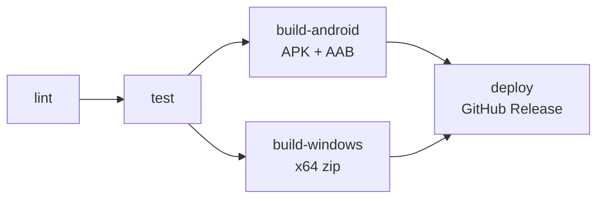

# CI/CD

В репозитории два workflow GitHub Actions. Пайплайн построен по схеме
**lint → test → build → deploy**: сначала проверки, затем тесты, затем параллельная
сборка под Android и Windows, и только после этого публикация.

| Workflow | Файл | Когда запускается | Этапы |
|---|---|---|---|
| **CI** | `.github/workflows/ci.yml` | Pull request в любую ветку, push в `main`, вручную | lint → test → build-android + build-windows |
| **Release** | `.github/workflows/release.yml` | Push тега `v*`, вручную | lint → test → build-android + build-windows → deploy |



В CI этап `deploy` не выполняется: pull request и обычный push в `main` только
собирают артефакты. Публикация релиза вынесена в отдельный workflow, который
запускается по тегу `v*` или вручную.

Оба workflow используют Flutter `3.47.6` и кэшируют SDK и pub-зависимости.
Для Android дополнительно кэшируется Gradle.

## Этапы

### 1. Lint

Job `lint` на `ubuntu-latest`:

1. `dart format --output=none --set-exit-if-changed lib test` — код должен быть отформатирован.
2. `flutter analyze` — без предупреждений и ошибок.

В Release workflow здесь же проверяется, что тег совпадает с версией из
`pubspec.yaml`. Например, тег `v1.1.0` требует `version: 1.1.0+N`.

### 2. Test

Job `test` запускается только после успешного `lint`:

- `flutter test --reporter expanded --coverage`;
- отчёт покрытия `coverage/lcov.info` прикладывается как artifact на 7 дней.

Покрыты:

- демо-авторизация (`test/demo_auth_test.dart`);
- CRUD-логика `PersonController` на in-memory Drift (`test/person_controller_test.dart`);
- экраны и навигация (`test/widget_test.dart`).

### 3. Build

Обе сборки запускаются параллельно после успешного `test`.

**Android** (`build-android`, `ubuntu-latest`, Temurin Java 17):

- `flutter build apk --release` → APK для установки на устройство;
- `flutter build appbundle --release` → AAB для Google Play;
- артефакты: `task_tracker_oridj-<version>-android.apk`,
  `task_tracker_oridj-<version>-android.aab`, `SHA256SUMS.txt`.

**Windows** (`build-windows`, `windows-latest`):

- `flutter build windows --release`;
- содержимое `build/windows/x64/runner/Release/` упаковывается в
  `task_tracker_oridj-<version>-windows-x64.zip`;
- рядом кладётся `SHA256SUMS.txt`.

Версия берётся из `pubspec.yaml`, номер сборки (`+N`) используется как
Android `versionCode`. Для каждого релиза увеличивайте и версию, и build number.

### 4. Deploy

Job `deploy` есть только в Release workflow. Он запускается после успешной
сборки обеих платформ, скачивает артефакты, формирует общий `SHA256SUMS.txt`
и создаёт GitHub Release с APK, AAB и Windows-архивом.

Deploy требует `contents: write`; остальные job'ы работают с `contents: read`.

## Подпись Android

Без секретов APK и AAB подписываются debug-ключом. Такая сборка устанавливается
вручную, но не подходит для Google Play.

Для release-подписи добавьте в **Settings → Secrets and variables → Actions**
четыре секрета:

| Секрет | Что содержит |
|---|---|
| `ANDROID_KEYSTORE_BASE64` | keystore, закодированный в base64 |
| `ANDROID_KEYSTORE_PASSWORD` | пароль хранилища |
| `ANDROID_KEY_ALIAS` | alias ключа |
| `ANDROID_KEY_PASSWORD` | пароль ключа |

Workflow декодирует keystore во временную папку runner'а и создаёт
`android/key.properties`. Если задан только `ANDROID_KEYSTORE_BASE64`, сборка
упадёт с понятной ошибкой: нужны все четыре секрета.

Локально файл `android/key.properties` создаётся вручную по образцу
`android/key.properties.example`. Он и файлы `*.jks` / `*.keystore` добавлены
в `.gitignore` и не должны попадать в репозиторий.

`storeFile` — путь к keystore относительно `android/app` или абсолютный путь.
В Windows используйте прямые слэши, например `C:/keys/release.jks`.

Пример создания keystore:

```powershell
keytool -genkeypair -v `
  -keystore android/app/release.jks `
  -keyalg RSA -keysize 2048 -validity 10000 `
  -alias release
```

Получить base64 для секрета:

```powershell
[Convert]::ToBase64String([IO.File]::ReadAllBytes("android/app/release.jks")) | Set-Clipboard
```

## Локальные проверки перед push

```powershell
flutter pub get
dart format lib test
flutter analyze
flutter test
```

`dart format lib test` не только проверяет, но и форматирует файлы. В CI
используется режим только проверки, поэтому неотформатированный код там упадёт.

Полная локальная проверка сборок:

```powershell
flutter build apk --release
flutter build appbundle --release
flutter build windows --release
```

## Как выпустить релиз

1. Обновите версию и build number в `pubspec.yaml`:

   ```yaml
   version: 1.1.0+2
   ```

   Первые три числа — версия приложения, число после `+` — build number.
   Для каждого нового релиза build number должен увеличиваться.

2. Закоммитьте изменение и влейте его в `main`.

3. Создайте и запушьте тег, совпадающий с версией:

   ```powershell
   git tag v1.1.0
   git push origin v1.1.0
   ```

4. Workflow **Release** выполнит lint → test → сборки → deploy и создаст
   GitHub Release с файлами:

   - `task_tracker_oridj-1.1.0-android.apk`;
   - `task_tracker_oridj-1.1.0-android.aab`;
   - `task_tracker_oridj-1.1.0-windows-x64.zip`;
   - `SHA256SUMS.txt`.

Тег должен указывать на коммит, в котором уже есть актуальный
`.github/workflows/release.yml`. Если тег не совпадает с `version` из
`pubspec.yaml`, сборка остановится с ошибкой.

### Ручной запуск

В GitHub: **Actions → Release → Run workflow**. Укажите существующий тег
(например, `v1.1.0`) и при необходимости отметьте pre-release.

## Где скачать сборку

- **CI**: вкладка **Actions → нужный запуск → Artifacts**. Android и Windows
  лежат отдельными artifact'ами, срок хранения — 14 дней.
- **Release**: раздел **Releases** репозитория, файлы хранятся бессрочно.

## Требования к репозиторию

- В **Settings → Actions → General** должны быть разрешены GitHub Actions.
- Для публикации релиза workflow запрашивает `contents: write`. Если в
  организации включён режим «Read repository contents permission» по умолчанию,
  явные `permissions` в workflow всё равно выдают токену нужный доступ.
- Android-сборка не требует секретов: без них используется debug-подпись.
- `.env` с параметрами PostgreSQL в релизный архив не попадает.

## Self-hosted runner

По умолчанию используются GitHub-hosted runners (`ubuntu-latest` и
`windows-latest`). Если нужен собственный runner (см.
`how-to_self-host-runner`), замените в workflow `runs-on` на свои метки,
например:

```yaml
runs-on: [self-hosted, "runner-${{ github.actor }}"]
```

Учтите:

- для Windows-сборки runner должен быть Windows-машиной с Visual Studio
  Build Tools (Desktop development with C++);
- для Android-сборки нужны Android SDK, Java 17 и принятые лицензии SDK;
- в workflow есть шаги `shell: pwsh` — на self-hosted Windows должен быть
  установлен PowerShell 7 либо эти шаги нужно заменить на `shell: powershell`;
- self-hosted runner в публичном репозитории не рекомендуется: код из pull
  request может выполниться на вашей машине. Используйте отдельную VM или
  Windows Sandbox без личных файлов и секретов.
